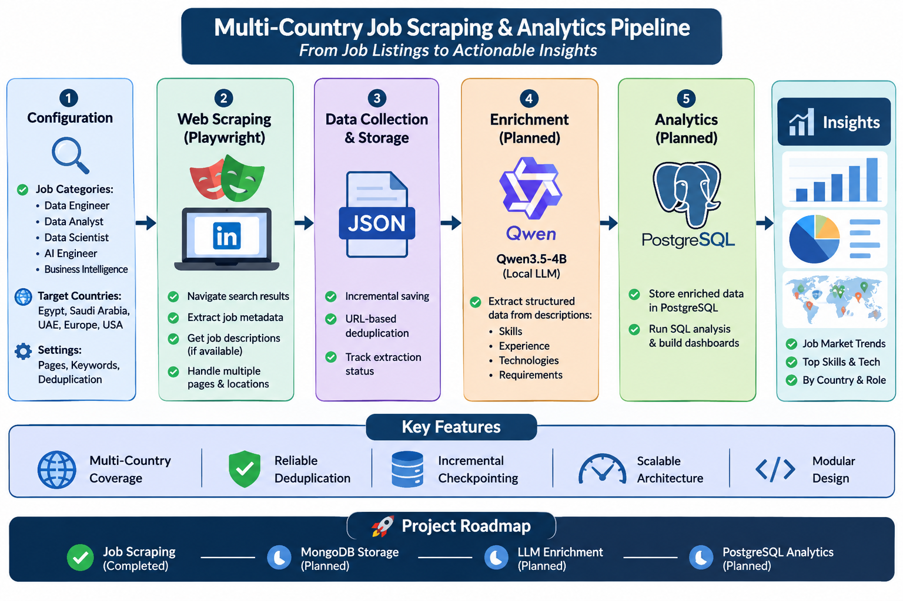

# Multi-Country Job Scraping System

A Python-based job scraping project designed to collect Data Engineer, Data Analyst, Data Scientist, AI Engineer, and Business Intelligence job listings from multiple countries using Playwright.

The project focuses on automating job discovery across different locations, collecting structured job information, extracting job descriptions where access is available, and maintaining a persistent dataset that can later be used for data processing and analysis.

> **Project Status:** In Progress

## Table of Contents

- [Overview](#overview)
- [Objectives](#objectives)
- [Supported Job Categories](#supported-job-categories)
- [Target Locations](#target-locations)
- [System Architecture](#system-architecture)
- [Data Collection Workflow](#data-collection-workflow)
- [Data Fields](#data-fields)
- [Duplicate Detection](#duplicate-detection)
- [Incremental Data Collection](#incremental-data-collection)
- [Planned Data Processing](#planned-data-processing)
- [Technology Stack](#technology-stack)
- [Project Structure](#project-structure)
- [Setup and Installation](#setup-and-installation)
- [Running the Scraper](#running-the-scraper)
- [Data Storage](#data-storage)
- [Current Limitations](#current-limitations)
- [Roadmap](#roadmap)
- [Responsible Data Collection](#responsible-data-collection)

## Overview

Finding relevant job opportunities across multiple countries and job categories can require manually searching many locations and collecting information from different listings.

This project aims to automate that process by developing a multi-country job scraping system using Python and Playwright.

The scraper navigates job search results, collects listing information, processes multiple pages, and stores the extracted records in JSON files. It also supports incremental collection to avoid losing previously collected data when a scraping session stops or encounters an access issue.

The planned next stages include storing raw job listings in MongoDB, using a locally deployed Qwen model to extract structured information from job descriptions, and loading enriched records into PostgreSQL.

## Objectives

- Automate job listing collection across multiple countries.
- Search across different data and technology-related job roles.
- Navigate multiple pages of search results.
- Extract job metadata and descriptions when accessible.
- Avoid duplicate records using job URLs.
- Save collected records incrementally to prevent data loss.
- Maintain job descriptions separately from listing metadata.
- Build a foundation for future job description processing and structured data storage.

## Supported Job Categories

The project targets several technology-related job categories:

| Category | Example Search Terms |
|---|---|
| Data Engineering | Data Engineer, ETL Developer, Data Integration Engineer |
| Data Analytics | Data Analyst, BI Analyst, Business Data Analyst |
| Data Science | Data Scientist, Machine Learning Scientist |
| Artificial Intelligence | AI Engineer, Machine Learning Engineer |
| Business Intelligence | BI Developer, Power BI Developer, Analytics Engineer |

Search terms can be extended as the project evolves.

## Target Locations

The scraper is designed to collect job listings from multiple geographical markets.

| Region | Target Countries |
|---|---|
| Middle East | Egypt, Saudi Arabia, United Arab Emirates |
| Europe | Selected European countries |
| North America | United States |

The country list and search configuration can be expanded to include additional locations.

## System Architecture

The architecture separates data collection, raw storage, LLM-based enrichment, and analytical processing into independent stages.



### Architecture Components

**1. Job Search Configuration**

Defines the job categories, search keywords, countries, and pagination settings.

**2. Web Scraping**

Python and Playwright automate browser navigation and collect job listing information.

**3. Data Extraction**

Extracts available metadata from job search results and attempts to retrieve detailed job descriptions.

**4. Duplicate Detection**

Uses job URLs to identify previously collected listings and avoid inserting duplicate records.

**5. Incremental Checkpointing**

Stores collected records in JSON so that progress is preserved during long-running scraping sessions.

**6. Data Storage — Planned**

MongoDB will be used to store raw job listings and their descriptions.

**7. Job Description Enrichment — Planned**

A locally deployed Qwen3.5-4B model will process unstructured job descriptions and extract structured information.

**8. Analytical Storage — Planned**

PostgreSQL will store enriched job records for SQL-based analysis.

## Data Collection Workflow

The scraping workflow consists of the following steps:

1. Load the configured job categories and target countries.
2. Open the job search page using Playwright.
3. Navigate through the available search result pages.
4. Extract listing metadata from the search results.
5. Check whether each job URL already exists in the collected dataset.
6. Save new job records to the JSON checkpoint.
7. Attempt to access individual job pages to extract descriptions.
8. Update the corresponding records with available descriptions and extraction status.
9. Continue with the next search location.

The collection process is designed to preserve listing metadata even when individual job descriptions cannot be accessed.

## Data Fields

Each collected job record is designed to contain the following information.

| Field | Description |
|---|---|
| `job_id` | Job identifier, when available |
| `job_title` | Position title |
| `company` | Hiring company |
| `location` | Job location |
| `job_url` | Original job listing URL |
| `description` | Extracted job description |
| `search_keyword` | Keyword used to discover the listing |
| `search_country` | Country used in the search |
| `description_status` | Status of description extraction |
| `scraped_at` | Date and time the record was collected |

### Example JSON Record

```json
{
  "job_id": "example-job-id",
  "job_title": "Junior Data Engineer",
  "company": "Example Company",
  "location": "Dubai, United Arab Emirates",
  "job_url": "https://www.linkedin.com/jobs/view/example",
  "description": "",
  "search_keyword": "Data Engineer",
  "search_country": "United Arab Emirates",
  "description_status": "login_required_for_details",
  "scraped_at": "2026-11-20T12:00:00"
}
```

*The example is illustrative; actual field availability depends on the listing and scraping stage.*

## Duplicate Detection

The scraper uses job URLs as the primary identifier for duplicate detection.

Before saving a newly discovered listing, the system checks whether its URL already exists in the dataset.

This helps prevent repeated records when:

- The same job appears under multiple search keywords.
- Search results overlap across pages.
- The scraper is executed more than once.
- A previous scraping session is resumed.

## Incremental Data Collection

Long-running scraping tasks can be interrupted by browser errors, access restrictions, or network problems.

To reduce data loss, the scraper uses incremental JSON checkpointing.

Instead of waiting until the entire scraping process finishes, collected records are saved progressively.

This provides several benefits:

- Previously collected records remain available after interruptions.
- New scraping sessions can load existing records.
- Duplicate records can be skipped.
- Missing job descriptions can be enriched separately.
- Metadata collection can continue even if description extraction is unavailable.

## Planned Data Processing

The next development stage will extend the scraper into a structured job data processing pipeline.

### 1. MongoDB — Raw Job Storage

Store the collected job listings and their descriptions in MongoDB.

The database will maintain the original scraped information before applying enrichment or transformation.

### 2. Local LLM — Job Description Extraction

A locally deployed Qwen3.5-4B model will process job descriptions and extract structured information, including:

| Attribute | Example |
|---|---|
| Technical Skills | Python, SQL, Apache Spark |
| Technologies | Airflow, Kafka, Snowflake |
| Experience Requirements | 0–2 years |
| Qualifications | Computer Science degree |
| Job Requirements | ETL development, data modeling |
| Job Responsibilities | Building and maintaining data pipelines |

The goal is to convert unstructured job descriptions into structured records that are easier to query and analyze.

### 3. PostgreSQL — Structured Storage

Enriched job records will be loaded into PostgreSQL.

This will provide a relational data layer for querying job requirements, comparing technologies, and analyzing job market trends across different roles and countries.

### 4. SQL-Based Analysis

The structured dataset can eventually support questions such as:

- Which technical skills are most frequently requested for Data Engineer positions?
- Which countries have more opportunities for entry-level data roles?
- How frequently do job descriptions require Python, SQL, Spark, and Airflow?
- What experience levels are requested across different job categories?
- Which technologies frequently appear together in job descriptions?

## Technology Stack

| Technology | Purpose |
|---|---|
| Python | Scraping logic and data processing |
| Playwright | Browser automation and job listing extraction |
| JSON | Incremental checkpointing and intermediate storage |
| MongoDB *(Planned)* | Raw job listing storage |
| Qwen3.5-4B *(Planned)* | Local job description enrichment |
| PostgreSQL *(Planned)* | Structured storage and SQL analysis |

## Project Structure

The project is organized around independent scraping and data processing components.

```text
multi-country-job-scraper/
│
├── linkedin_fetch_all_jobs.py
├── linkedin_fetch_all_jobs_incremental.py
├── linkedin_fetch_all_jobs_incremental_fixed.py
├── linkedin_enrich_descriptions.py
│
├── data/
│   └── jobs.json
│
├── linkedin_browser_profile/
│
├── requirements.txt
├── .gitignore
└── README.md
```

*The structure is illustrative and should be adjusted to match the actual repository files.*

## Setup and Installation

### Prerequisites

- Python 3.10 or later
- Google Chrome or a supported Playwright browser
- Git
- A LinkedIn account for manually accessing pages that require authentication

### 1. Clone the Repository

```bash
git clone YOUR_REPOSITORY_URL
cd multi-country-job-scraper
```

### 2. Create a Virtual Environment

```powershell
python -m venv venv
```

Activate the environment:

```powershell
.\venv\Scripts\Activate.ps1
```

### 3. Install Dependencies

```bash
pip install playwright
```

Install the required Playwright browser:

```bash
playwright install chromium
```

Install any additional dependencies listed in `requirements.txt` if applicable.

## Running the Scraper

Run the incremental scraper:

```bash
python linkedin_fetch_all_jobs_incremental_fixed.py
```

The scraper will:

1. Load previously collected records, if available.
2. Navigate through configured job searches.
3. Extract available listing metadata.
4. Skip previously collected job URLs.
5. Save new records incrementally.
6. Attempt to retrieve job descriptions where accessible.

### Description Enrichment

The separate description enrichment script is intended to process previously collected records with missing descriptions:

```bash
python linkedin_enrich_descriptions.py
```

This allows description extraction to be retried without collecting the same listing metadata again.

## Data Storage

The current collection stage uses JSON files to maintain the scraped dataset.

JSON provides a simple intermediate storage format that supports:

- Incremental updates.
- Easy inspection and debugging.
- Data portability.
- Integration with future database storage.

The planned storage workflow is:

```text
Job Listings
     |
     v
JSON Checkpoint
     |
     v
MongoDB
     |
     v
Qwen Description Enrichment
     |
     v
PostgreSQL
```

## Current Limitations

The project is still under development, and some limitations remain:

- Job description pages may require authentication.
- Some listings may become unavailable or expire.
- Search result pages may return overlapping listings.
- Pagination behavior needs validation to ensure different page offsets return distinct results.
- Description extraction is not guaranteed for every listing.
- MongoDB storage, local LLM enrichment, and PostgreSQL integration are planned rather than completed.

The scraper records description extraction status so that inaccessible descriptions can be identified and retried separately.

## Roadmap

- [x] Build initial Python and Playwright scraping workflow.
- [x] Collect job listing metadata from search results.
- [x] Implement URL-based duplicate detection.
- [x] Add incremental JSON checkpointing.
- [x] Separate job description enrichment from metadata collection.
- [ ] Validate pagination across all configured search locations.
- [ ] Improve description extraction reliability.
- [ ] Integrate MongoDB for raw job storage.
- [ ] Deploy Qwen3.5-4B locally for job description extraction.
- [ ] Design structured job data schema.
- [ ] Integrate PostgreSQL for enriched job records.
- [ ] Build SQL queries for cross-country job market analysis.

## Responsible Data Collection

This project is intended for educational and portfolio purposes.

When collecting job listing information:

- Respect the website's Terms of Service and applicable policies.
- Follow robots directives and access restrictions where applicable.
- Use reasonable request rates.
- Do not bypass authentication, CAPTCHAs, access controls, or security challenges.
- Do not store account credentials in source code.
- Use manually authenticated sessions only where permitted.
- Avoid collecting unnecessary personal or sensitive information.

If access is restricted, the collection process should stop or skip the affected pages rather than attempt to circumvent the restriction.

---

## Author

**Mohamed Diaa**

Data Engineering | Python | SQL | Data Pipelines

GitHub: [MOdiaa2003](https://github.com/MOdiaa2003)

---

*This README describes the current scraping implementation and the planned database and LLM enrichment stages. Implementation status should be updated as each component is completed.*
